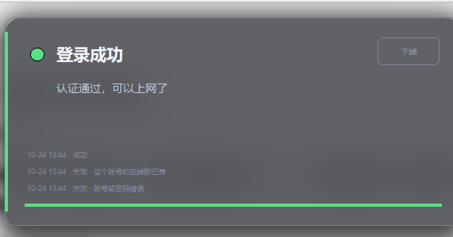
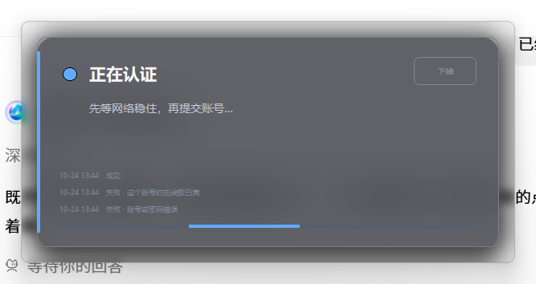
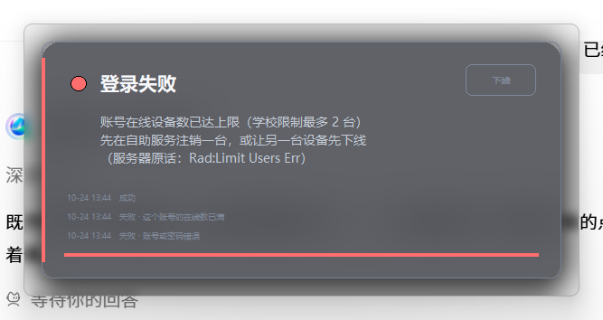

<div align="center">

# 校园网一键登录

**Dr.COM eportal 校园网自动认证 · Windows 桌面版 + Android 版**

点一下图标，它自己认网、自己切 Wi-Fi、自己认证，最后再确认一遍是不是真能上网

[](https://github.com/Heng-yitai/campus-autologin/actions/workflows/test.yml)
[](https://www.python.org/)
[](#)
[](#安卓版)
[](#依赖说明)
[](#测试)

[功能](#它解决了什么问题) · [快速开始](#快速开始) · [工作原理](#工作原理) · [适配自己的学校](#适配自己的学校) · [故障排查](#故障排查)

</div>



---

## 它解决了什么问题

Dr.COM 认证的校园网有个烦人的循环：**连上 Wi-Fi → 打开浏览器 → 被跳到门户页 → 输账号密码 → 点登录 → 等十几秒**。
一天要重复好几次，断线了还得从头再来。

这个工具把它变成**一次双击**：

```
点图标 → 判断当前在哪 → 不在校园网就切过去 → 等 DHCP → 提交认证 → 核对真的能上网 → 显示结果
```

全程只有一块半透明面板，文字原地更新，不会"弹一个消失、再弹一个消失"。

### 它和同类工具的区别

大部分校园网脚本只做"发一个认证请求"。这个工具在真实环境里跑了两个多月，
踩过的坑都写进了代码和注释里。差异主要在这几点：

| | 常见脚本 | 本项目 |
|---|---|---|
| 认证成功判定 | 看服务器返回 `result=1` | **再访问公网验证一次**，不被"假在线"骗 |
| 会话无声失效 | 不管 | 检测到"服务器说在线但上不了网"→ 自动注销旧会话 + 重新认证 |
| 换楼栋 | 写死一个 SSID，换个楼就"扫不到" | 支持多个 SSID，自动挑附近可见的那个 |
| 切网失败 | 反复重试，越等越久 | 失败就把原来的网还给你，明确告诉你下一步做什么 |
| 密码 | 明文存在配置文件 | Windows DPAPI 加密，**换电脑也解不开** |
| 长期断网 | 得自己发现 | 可选守护进程每 60 秒体检一次，断了自动修复 |
| 界面 | 黑框或系统弹窗 | 自绘毛玻璃面板，DPI 感知，跟随系统深浅色 |
| 依赖 | requests / pywin32 / Qt | **运行时零必需依赖**，纯标准库；Pillow 可选，只影响毛玻璃效果 |

---

## 快速开始

### Windows 桌面版

**环境要求**：Windows 10 / 11，Python 3.8+（实测 3.13）

不需要装任何第三方包就能跑。唯一可选的组件是 Pillow：

```bash
pip install pillow      # 可选
```

装了才会用「抓屏 + 高斯模糊」自己合成毛玻璃背景；**不装也能正常登录**，
面板会自动退回 Windows 系统自带的 Acrylic 材质，再不行就纯色实底。
日志里会记一句「自制毛玻璃失败」，那不是报错，是降级。

```bash
git clone https://github.com/Heng-yitai/campus-autologin.git
cd campus-autologin
```

**第一步：录入账号密码**（只需一次）

```bash
python setup_credentials.py
```

按提示输入学号和密码，选择运营商（电信 / 移动 / 联通）。
密码会用 Windows DPAPI 加密后写入 `config.dat`，**密钥与当前 Windows 账户绑定**，
把文件拷到别的电脑也解不开。

**第二步：跑起来**

```bash
pythonw campus_login.py
```

`pythonw` 不会弹出控制台窗口，更像一个正常的桌面程序。

**第三步（可选）：做成桌面图标**

右键 `campus_login.py` → 发送到 → 桌面快捷方式。
或者直接双击 `run_login.vbs`（静默启动，会自动找 Python）。

**第四步（可选）：开机自动守护**

双击 `守护-启动.cmd`。之后它每 60 秒确认一次真实出网，断了自己修。
停止用 `守护-停止.cmd`，看状态用 `守护-状态.cmd`。

> 想打包成单个 exe 发给不会装 Python 的同学：
>
> Windows 上双击 `打包exe.cmd` 就行。它会自己找 Python（跳过应用商店那个
> 假的 `python.exe`），没装 PyInstaller 就顺手装上，然后打出 exe，
> 连说明书一起压成 `发布/校园网一键登录-v6.zip`。
>
> 手动也行：
> ```bash
> pyinstaller -F -w -i icon.ico --name "校园网一键登录" campus_login.py
> ```
> 打完配置文件和日志都跟着 exe 走，放在同一个目录里。别把 config.dat 一起发出去。

### 安卓版

见 [`android/README.md`](android/README.md)。

简单说：Android 7.0 ~ 14，源码 6 个文件、约 1750 行，不用 Gradle 也能编
（`aapt2 → javac → d8 → zipalign → apksigner` 一条 `build.sh` 跑完）。

功能跟电脑版一致：**自己开 Wi-Fi、自己找已保存的校园网、自己认证**。

---

## 界面

| 进行中 | 成功 | 失败 |
|---|---|---|
|  |  |  |

面板是**自绘**的：截取背后的屏幕内容 → 高斯模糊 → 与半透明底色合成 → 圆角裁剪。
没有引入任何 UI 框架，全靠 `ctypes` 调 Win32 API（`CreateWindowExW` / `DrawTextW` / `SetProcessDpiAwarenessContext`）。

面板上还有：
- **最近三条认证记录**（灰字），一眼看出是不是一直卡在同一个错上
- **右上角「下线」按钮**，两步确认防误触 —— 用来释放本机会话，好让手机登录（学校一般限制同时在线上限）

---

## 工作原理

```
┌──────────────┐
│  双击图标     │
└──────┬───────┘
       ▼
┌──────────────────────────┐
│ 1. 现在连的是哪个 Wi-Fi？ │
└──────┬───────────────────┘
       ├── 已经是校园网 ────────────────┐
       │                                │
       └── 不是（热点 / 别的网）         │
              ▼                         │
   ┌────────────────────────┐           │
   │ 2. 点名扫描目标 SSID    │           │
   │    （WlanScan + 确认可见）│         │
   └──────┬─────────────────┘           │
          ▼                             │
   ┌────────────────────────┐           │
   │ 3. WlanConnect 切换     │           │
   │    失败则强制断开后再试  │           │
   └──────┬─────────────────┘           │
          ▼                             │
   ┌────────────────────────┐           │
   │ 4. 等 DHCP 拿到 IP      │           │
   └──────┬─────────────────┘           │
          ▼                             ▼
   ┌──────────────────────────────────────┐
   │ 5. 提交认证（账号@运营商 + 本机 IP）    │
   └──────┬───────────────────────────────┘
          ▼
   ┌──────────────────────────────────────┐
   │ 6. 真的能上网吗？                      │
   │    4 个公网探测点并行，谁先通算谁通      │
   └──────┬───────────────────────────────┘
          ├── 通 ──→ 「登录成功」
          │
          └── 不通 ──→ 服务器说在线但没网？
                        → 注销本机 IP 的旧会话
                        → 重新认证
```

### 几个关键设计

**「服务器说成功」不等于「你能上网」**

门户是**按 IP 记账**的。它的会话表里可能留着这台电脑的记录，但网关那边早就不放行了
（会话被判失效、被顶号、长时间无流量）。这种状态下服务器照样回「已经在线」，
甚至直接给 `result=1` —— 可网页打开全是门户页。

所以认证之后必须**访问公网地址看有没有被劫持**。这个工具用 4 个探测点**并行**发
（小米 / vivo / 华为 / Apple 各一个），谁先通用谁，两轮都全挂才判失败。

**换楼栋就"扫不到校园网"**

同一个学校不同区域可能是不同的 SSID（宿舍一个、教学楼另一个）。
只认一个名字的程序就会在换楼时判定"周围没有校园网"——哪怕电脑明明扫到了。

所以 SSID 做成一个列表，程序自己挑附近可见的那个：

```python
CAMPUS_SSIDS = ("6#SS-WiFi", "FYLG-WIFI")
```

**别用"上次扫描的缓存"去连**

`WlanConnect` 之前必须对目标 SSID 做一次**点名扫描**并确认它真的在列表里。
驱动手里没有这个网络的新鲜记录时，关联会当场失败，系统事件日志报
「特定的网络不可用 / RSSI 255」—— 看着像没信号，其实是被挡在关联阶段。

**已有无线配置绝不动**

早期版本为了给校园网写"不用随机 MAC"，改成了每次覆盖重建配置。
结果切回手机热点时，程序把热点当成新网络又加了一遍，Windows 生成了
一条**空密码的同名配置**（`热点 2`），之后系统优先匹配到冒牌货，热点再也连不上。

教训写进代码注释了：**任何"重建配置"的动作都可能毁掉别人的密码。已有配置一律原样保留。**

---

## 适配自己的学校

工具默认按作者的学校配置。换学校只需要改 `campus_login.py` 顶部这几行：

| 常量 | 含义 | 怎么找 |
|---|---|---|
| `PORTAL_HOST` | 认证服务器地址 | 连上校园网后随便打开一个网页，看被跳到哪个 IP |
| `PORTAL_PORT` | 认证端口（常见 801 / 8080） | 同上，看 URL 里的端口 |
| `LOGIN_PATH` | 登录接口路径 | Dr.COM 常见 `/eportal/portal/login` |
| `CAMPUS_SSIDS` | 校园网 Wi-Fi 名称，可写多个 | 手机 Wi-Fi 列表里看到的那个 |

```python
PORTAL_HOST = "192.168.0.252"          # 认证服务器
PORTAL_PORT = 801                      # 认证接口端口
LOGIN_PATH = "/eportal/portal/login"   # 登录接口
CAMPUS_SSIDS = ("你的校园网", "另一个楼的名字")
```

运营商后缀在 `setup_credentials.py` 里选（`@telecom` / `@cmcc` / `@unicom`）。

> **怎么确认自己的门户是哪一版？**
> 连上校园网，浏览器访问 `http://门户IP:端口/eportal/portal/login`。
> 返回 `jsonpReturn({"result":0,...})` 就是本文支持的老版接口。
> 如果返回 404「系统发生错误」，那你的门户可能是新版 `InterFace.do` 接口（本文未适配）。

---

## 依赖说明

| 组件 | 是否必需 | 作用 | 缺失时 |
|---|---|---|---|
| Python 3.8+ | **必需** | 运行环境 | 跑不起来 |
| Pillow | 可选 | 抓屏 + 高斯模糊，自制毛玻璃背景 | 自动退回系统 Acrylic，再退回纯色实底 |

其余全部是 Python 标准库（`ctypes` / `urllib` / `json` / `socket` / `subprocess` 等）。

这条承诺不是靠嘴说的：`scripts/check_deps.py` 会扫描所有运行时文件，
CI 每次 push 都跑一遍。哪天主程序不小心 `import requests` 了，构建会直接变红，
而不是等用户在没装包的机器上才发现。

```bash
python scripts/check_deps.py
```

---

## 安全性

这一块是这个工具最在意的部分，也是代码里注释最多的地方。

**密码怎么存的**

```
明文密码 ──DPAPI(CryptProtectData)──→ config.dat
                ▲
                └── 密钥：当前 Windows 用户的登录凭据
```

- 用 Windows 自带的 DPAPI，不自己造加密算法
- 加密密钥与**当前 Windows 账户**绑定：把 `config.dat` 拷给别人、或换台电脑，都解不开
- 密码任何时刻都不会以明文写入磁盘或日志

**日志里有什么**

只记：时间、当前 SSID、本机出口 IP、耗时、服务器返回的结果码。
**不记密码**，也不记完整请求 URL。

**不会做的事**

- 没连上校园网时**绝不提交账号密码**（手机热点借校园网出口时，认证服务器同样可达，
  但服务器看到的来源不对，会回"账号或密码错误"这种误导结果 —— 这种路径下直接不提交）
- 不修改 DNS、不修改代理、不动系统网络设置
- 下线请求用的是固定的注销凭据（`drcom`/`123`，Dr.COM 协议自带的），不涉及你的账号密码

**自己验证一遍**

`flow_test.py` 把**所有会碰网络的函数全部打桩**：不发一个包、不切一次网、不弹窗，
照样能验证完整流程。想确认它没偷偷联网，读这个文件就行。

---

## 测试

```bash
python flow_test.py
```

11 个场景，全部通过：

| | 场景 |
|---|---|
| A | 已经连着校园网 → 直接认证 |
| B | 连着校园网但门户还没就绪 → 等一会儿再认证 |
| C | 在手机热点上 → 切到校园网再认证 |
| D | 不在校园网、周边也搜不到 → **不认证、不瞎等** |
| D2 | 教学楼：校园网叫另一个名字 |
| D3 | 已经连着教学楼校园网 → 不切换，直接认证 |
| E | 切过去连上了、但一直上不了网 → 切回原网络 |
| F | 服务器说密码错 → 直接停，不反复重试 |
| G | 在线数超限（临时） → 自动重试后成功 |
| H | 服务器说「系统忙」 → 等一会儿再试，第二次成功 |
| I | 全程一个包都没发出去 |

测试自带一份假配置，**不需要真实账号密码就能跑**（克隆下来直接 `python flow_test.py`）。

---

## 故障排查

真实踩过的坑，按发生频率排序：

### 扫得到校园网，但一连就失败（系统日志 `RSSI: 255`）

系统事件日志里是这样：

```
id=11000  已开始无线网络关联  SSID: XXX  本地 MAC: 1A:2B:..
id=8002   无法连接   失败原因: 特定的网络不可用   RSSI: 255
```

扫描时信号 100%，真要关联时却说"网络不可用、RSSI 255（读不到信号）"。

**先重启。** 注意是**重启**，不是关机再开机 —— Windows 默认开着「快速启动」，
点"关机"再开机内核和网卡驱动都是从休眠镜像恢复的，等于没重启。

怎么确认自己是不是真重启了：

```powershell
(Get-CimInstance Win32_OperatingSystem).LastBootUpTime
```

时间没变，就是假重启。真正的重启记录在系统日志 `Kernel-General` 事件 `id=12`。

重启后仍然这样的话，依次试：设备管理器里禁用/启用网卡 → 忘记网络重连 → 更新网卡驱动。

### 提示「已在线」但网页打不开

门户的会话表还记着这台电脑，网关那边已经不放行了（僵尸会话）。
本工具的守护进程会自动检测并注销重登。手动修可以点「下线」按钮，等几秒再重新登录。

如果反复出现，检查是不是同一个账号在手机上也登着（学校一般限制 2 台同时在线）。

### 手机提示 `Rad:Limit Users Err`

不是密码错，是**在线设备数超了**。在电脑上点「下线」按钮释放名额，再让手机登录。

### 提示 `Rad:Passwd_Err`

这条容易误解：它说的**不是**你的登录密码，而是绑定的**宽带账号**密码错了。
需要去学校自助服务重绑（账号一般填手机号）。

### 提示「系统忙」/ `ret_code: 3`

学校的认证服务器繁忙，不是你的问题。工具会自动等 12 秒、25 秒再试。

---

## 已知局限

诚实写在这里，省得你踩了才发现：

- **只支持老版 eportal 接口**。新版 Dr.COM 的 `InterFace.do`（带 RSA 密码加密、
  服务列表 `getServices`）没有适配。作者的学校实测是老版接口，没有环境测试新版。
- **只支持开放式（无密码）无线网络**。需要 WPA2-Enterprise 认证的校园网用不了。
- **桌面版只支持 Windows**。用到大量 Win32 API（DPAPI、WlanConnect、自绘窗口），
  Linux / macOS 需要重写网络与 UI 层。
- **不知道你学校的门户地址**。`PORTAL_HOST` 需要自己填（见[适配自己的学校](#适配自己的学校)）。
- **安卓版需要定位权限**。Android 12 及以下，系统规定"读 Wi-Fi 名称"必须给定位权限。
  程序只用它识别 Wi-Fi，不读取、不上传位置信息（清单里已标注 `neverForLocation`）。
- **守护进程是定时轮询，不是事件驱动**。断网后最多 60 秒才会被修复，
  不是瞬间恢复。
- **不装 Pillow 就没有自制毛玻璃**。面板会退回系统 Acrylic 或纯色实底，
  功能不受影响，只是没那么好看。

---

## 项目结构

```
campus-autologin/
├── campus_login.py           主程序：网络判断、切 Wi-Fi、认证、自绘面板（约 2200 行）
├── net_guard.py              守护进程：每 60 秒体检，断了自动修
├── setup_credentials.py      录入账号密码（DPAPI 加密）
├── flow_test.py              11 个场景的流程测试（全打桩，不联网）
├── run_login.vbs             静默启动器（不弹黑框）
├── run_guard.vbs             守护进程启动器
├── 守护-启动.cmd / 停止 / 状态
├── make_icon.py              生成应用图标（需要 Pillow，仅开发用）
├── icon.ico / icon.png       图标资源
├── scripts/
│   └── check_deps.py         检查运行时是否只用标准库（CI 每次都会跑）
├── .github/workflows/        CI：Windows 上跑 11 个场景的测试
├── docs/
│   ├── 使用说明.md            详细使用文档
│   └── screenshots/          界面截图
└── android/                  安卓版（见 android/README.md）
    ├── AndroidManifest.xml
    ├── build.sh              不用 Gradle 的最小构建脚本
    ├── src/com/.../          6 个 Java 文件，约 1750 行
    ├── res/                  布局、颜色、深浅色主题
    └── test/MockPortal.py    模拟门户，用于离线测试
```

---

## 参与贡献

欢迎提 Issue 或 PR。下面这几类最有用：

- 你学校也能用。把门户地址和 SSID 说一下，我把配置示例补进文档
- 适配了新版 `InterFace.do` 接口。这块缺口最大，谁补上都行
- macOS / Linux 移植。网络层和 UI 层都得重写，工作量不小

提交前请跑一遍 `python flow_test.py`，确保 11 个场景都还是绿的。

---

## License

[MIT](LICENSE)

---

<details>
<summary><b>关于本项目的适配环境</b>（点击展开）</summary>

<br>

本项目最初是为**阜阳理工学院**的校园网写的，实际运行环境：

| 项 | 值 |
|---|---|
| 认证系统 | Dr.COM eportal（老版 JSONP 接口） |
| 认证服务器 | `192.168.0.252:801` |
| 校园网 SSID | 宿舍 `6#SS-WiFi`、教学楼 `FYLG-WIFI` |
| 运营商 | 中国电信（`@telecom`） |
| 客户端 | Windows 11 + Realtek 8852BE 网卡 / Android 13 |

代码里的 `192.168.0.252` 和上面这两个 SSID 就是这所学校的环境。
换学校请按[适配自己的学校](#适配自己的学校)一节修改 —— 逻辑部分不需要动。

</details>
